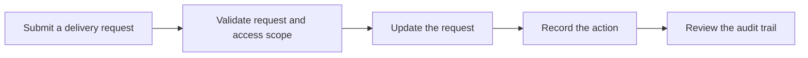

# VectorLog

VectorLog is a prototype for managing delivery requests, controlling who can act on them, and reviewing an audit trail.

## What the prototype covers

- Delivery requests that move through a validation and update workflow.
- Roles and access scopes that govern which delivery actions a user may take.
- An audit view that lets authorized users review recorded actions.

## Example workflow

The diagram uses a fictional delivery request to show how validation, access checks, and audit work together.

